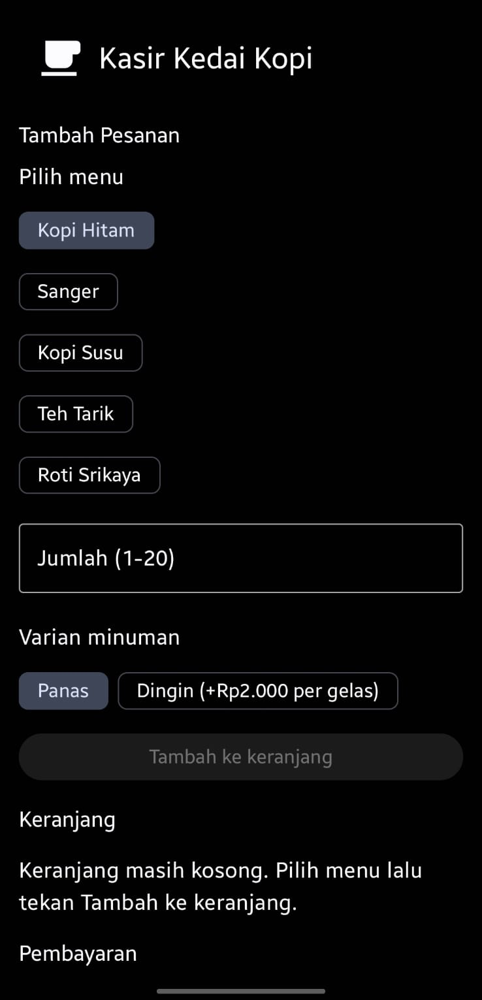
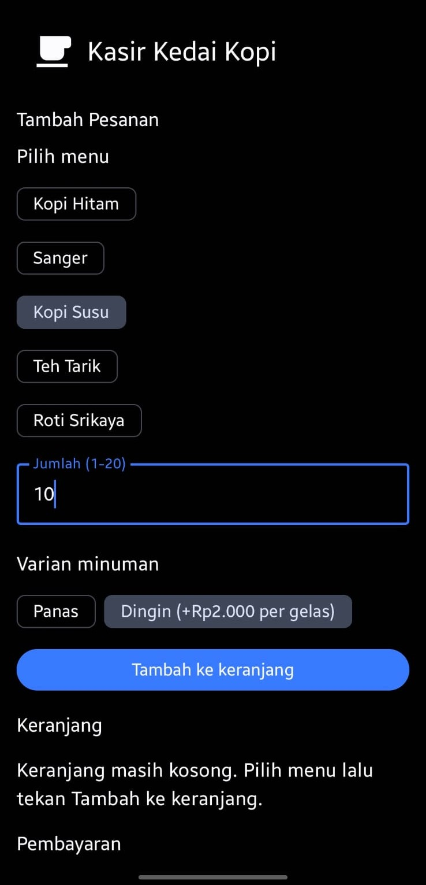
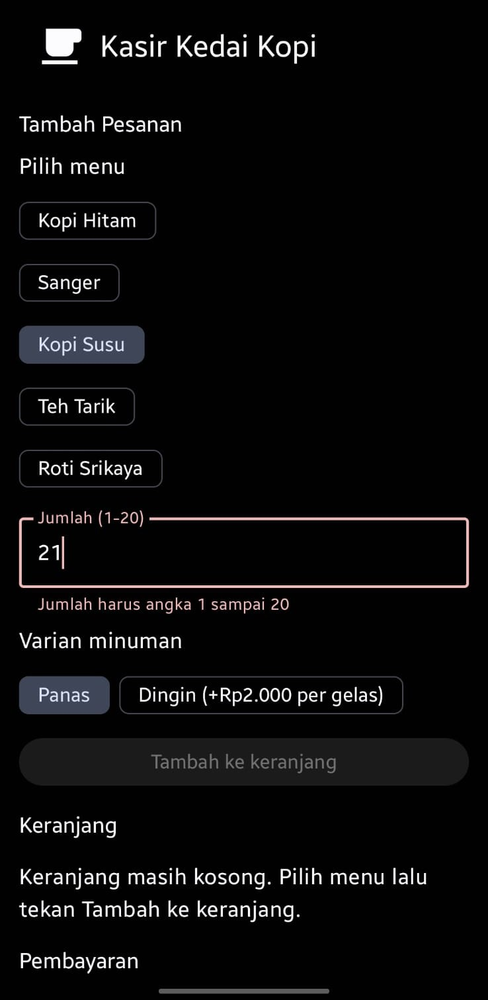

# KasirKopi: Kasir Kedai Kopi

UTS Pemrograman Berbasis Mobile (FT454), Semester Ganjil 2026/2027
Program Studi Teknologi Informasi, Fakultas Teknik, Universitas Teuku Umar
Dosen: Rivansyah Suhendra, S.Kom., M.T.

## Identitas Kelompok

- **Kelompok:** 05
- **Kasus:** 1, Kasir kedai kopi

| No | Nama | NIM | Akun GitHub | Bagian kode |
|----|------|-----|-------------|-------------|
| 1 | Teuku Fajar Rizki (ketua) | 2305903040068 | teukufajarrizky-creator | `Model.kt`, `Logika.kt`, `LogikaTest.kt`, `KasirScreen.kt`, `MainActivity.kt`, `strings.xml` |
| 2 | Agil Adinda Riza | 2305903040075 | Agil-riza | `FormPesanan.kt` |
| 3 | Tara Rosita | 2305903040033 | tararosita | `KartuItem.kt` |
| 4 | Syarifah Alya Ramatillah | 2305903040006 | syarifahalya | `RingkasanPenjualan.kt` |
| 5 | Rani Dhairi Ummayyah Maha | 2305903040040 | RaniiDhairi | `HeaderKedai.kt` |

## Video Presentasi

[UTS PBM 2026 – Kelompok 05 – Kasir Kedai Kopi](LINK_YOUTUBE_ISI_DI_SINI)

## Tentang Aplikasi

Aplikasi kasir sederhana satu layar untuk kedai kopi, dibuat dengan Kotlin dan Jetpack Compose 
Fitur utama:

- Menu tetap: kopi hitam Rp5.000, sanger Rp8.000, kopi susu Rp10.000, teh tarik Rp8.000, roti srikaya Rp6.000.
- Jumlah pesanan 1 sampai 20. Minuman dingin ditambah Rp2.000 per gelas.
- Menu dan varian yang sama digabung di keranjang.
- Subtotal Rp100.000 atau lebih mendapat diskon 10%.
- Tombol Bayar aktif hanya bila keranjang tidak kosong dan uang mencukupi.
- Setelah bayar, tampil kembalian dan keranjang dikosongkan.
- Ringkasan jumlah transaksi dan total penjualan sejak aplikasi dibuka.

## Tangkapan Layar

| Keadaan kosong | Keranjang berisi | Pesan kesalahan |
|----------------|------------------|-----------------|
|  |  |  |

## Struktur Kode

```
app/src/main/java/com/example/kasirkopi/
├── Model.kt                 data class dan daftar menu
├── Logika.kt                fungsi perhitungan dan validasi
├── KasirScreen.kt           composable induk (state disimpan di sini)
├── MainActivity.kt          titik masuk aplikasi
├── HeaderKedai.kt           header layar dengan ikon
├── FormPesanan.kt           formulir pesanan dan validasi
├── KartuItem.kt             kartu item keranjang dan tombol hapus
└── RingkasanPenjualan.kt    ringkasan transaksi
app/src/test/java/com/example/kasirkopi/
└── LogikaTest.kt            unit test fungsi logika
```

## Cara Menjalankan

1. Pasang Android Studio versi stabil terbaru.
2. Clone repositori:
```
   git clone https://github.com/teukufajarrizky-creator/uts-pbm-2026-kelompok-05.git
```
3. Buka folder hasil clone di Android Studio (File > Open) dan tunggu Gradle Sync selesai.
4. Pilih konfigurasi **app**, pilih emulator atau ponsel (minimal API 24), lalu klik Run.
5. Untuk menjalankan unit test: klik kanan `LogikaTest.kt` > Run.

## Asumsi

- Nama paket proyek adalah `com.example.kasirkopi` (bukan `id.ac.utu.kasirkopi`).
- Uang yang dibayarkan diisi dalam rupiah bulat tanpa titik atau koma.

## Penggunaan AI

AI digunakan sebagai alat bantu. Rincian lengkap ada di laporan.

- Dibantu AI dengan cara pengecheckan selaras atau tidaknya kode dan di-commit oleh ketua: `Model.kt`, `Logika.kt`, `LogikaTest.kt`, `strings.xml`, `KasirScreen.kt`, `MainActivity.kt`, serta kerangka awal `FormPesanan.kt`, `KartuItem.kt`, `RingkasanPenjualan.kt`, dan `HeaderKedai.kt`.
- Isi `FormPesanan.kt`, `KartuItem.kt`, `RingkasanPenjualan.kt`, dan `HeaderKedai.kt` ditulis oleh masing-masing anggota. Penggunaan AI mereka untuk belajar dicatat di laporan.
